# bamfmenu

A POST-style boot screen for BAMFOS, with a built-in pack updater and BIOS minigames.

Press `DEL` during boot to open the BIOS menu where the update tools, settings, and games live.

## Booting

**Normal boot, nothing to do**

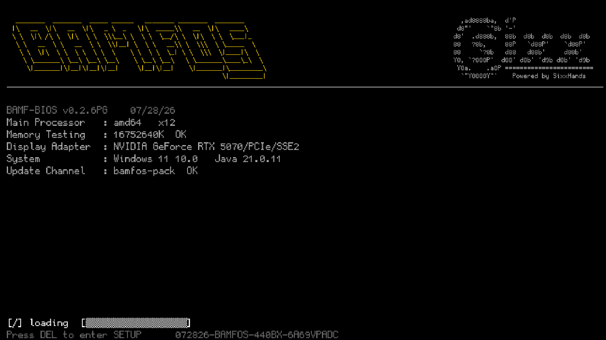

**Downloading a pack update**

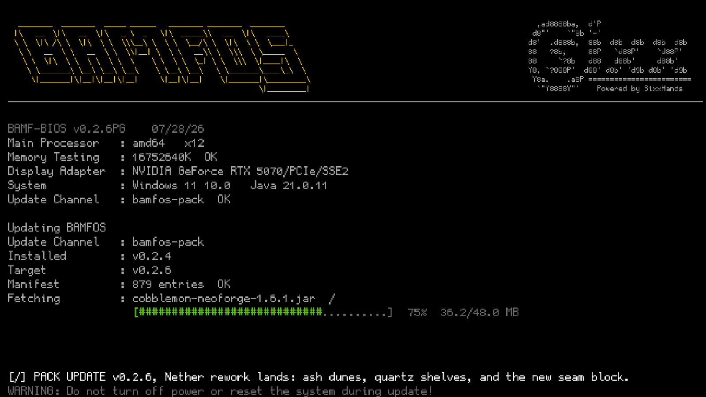

**Applying the downloaded files**

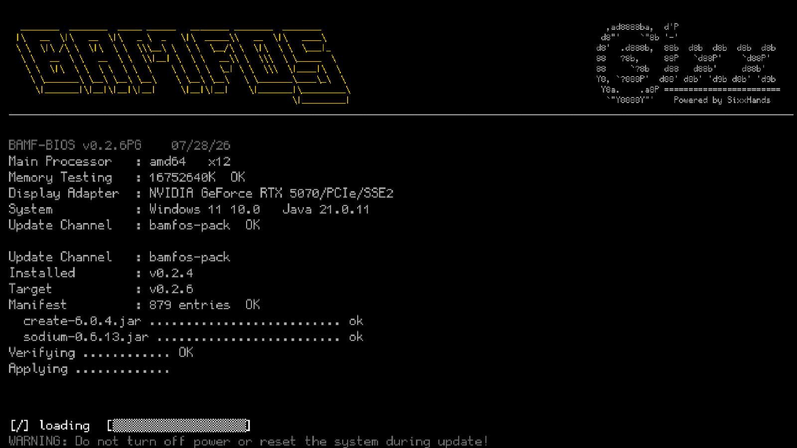

**Update finished**

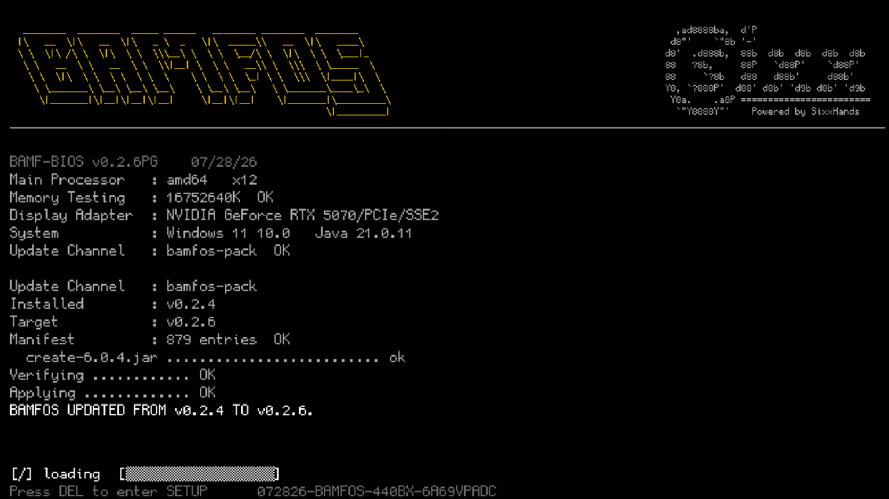

**Reboot needed to finish**

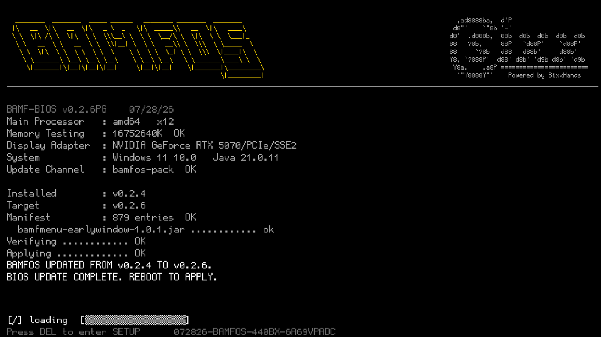

## When it cannot update

**GitHub Rate Limiting**

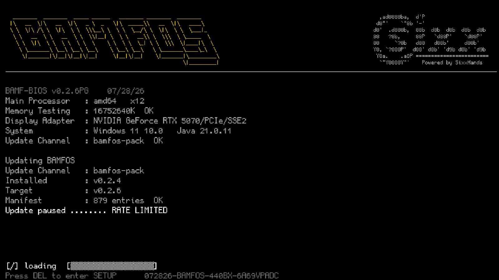

**No connection**

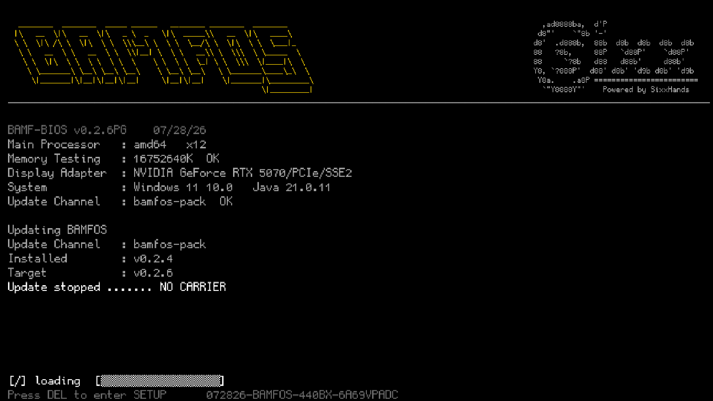

**The sync failed**

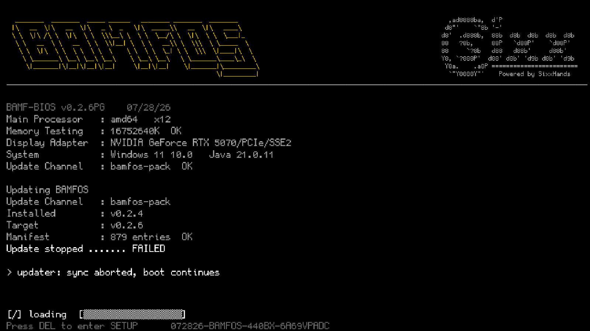

**Kicked for a version mismatch**

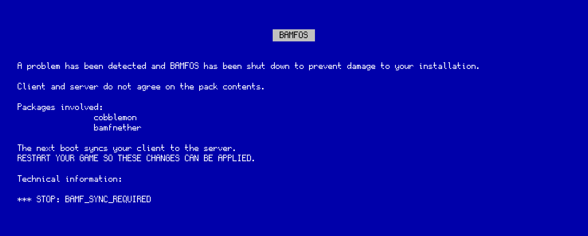

## The BIOS

**Main setup menu**

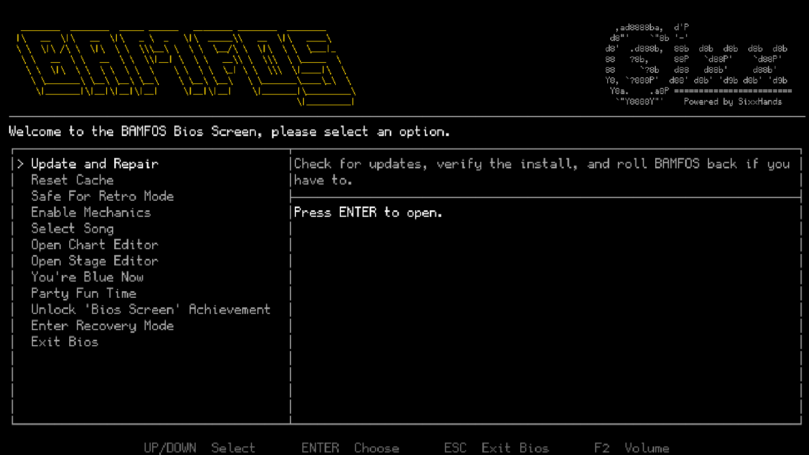

**The update and repair window**

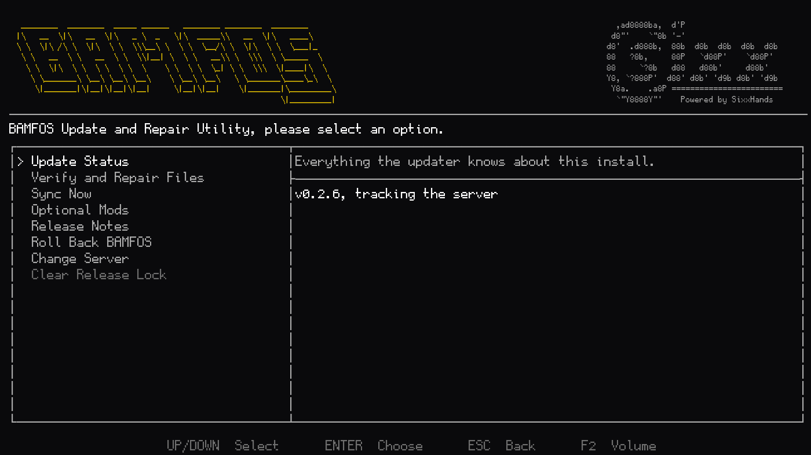

**Update status page**

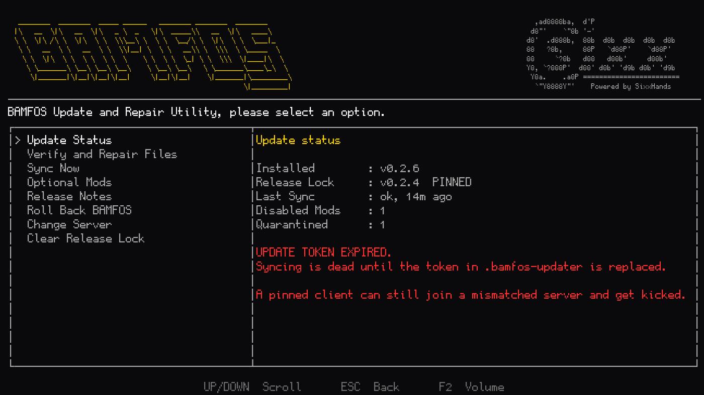

**Running a sync by hand**

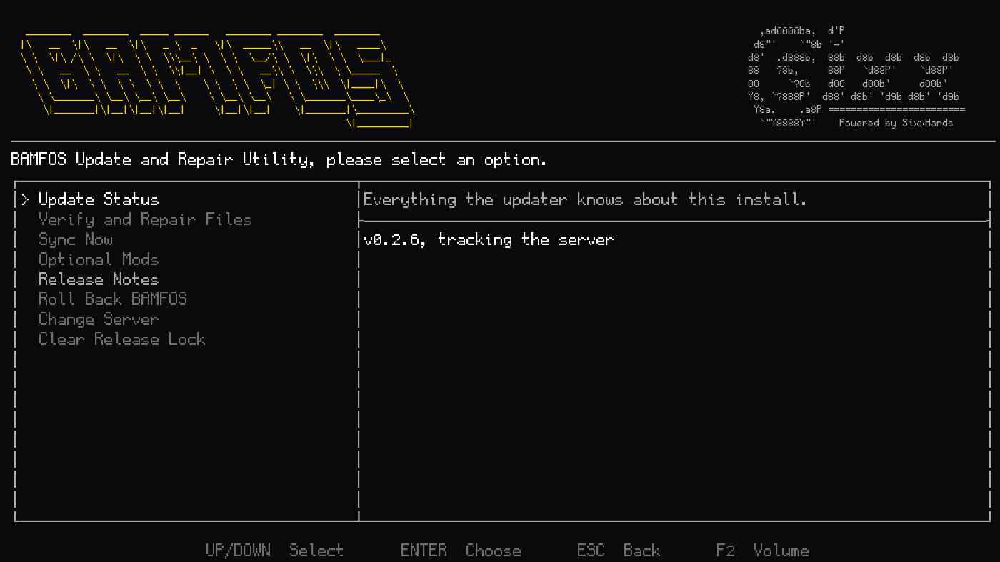

**Turning optional mods on and off**

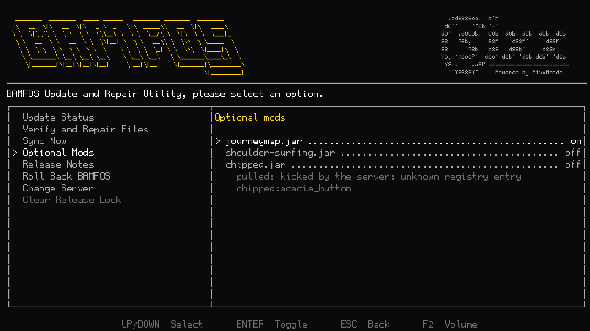

**Rolling back to an older release**

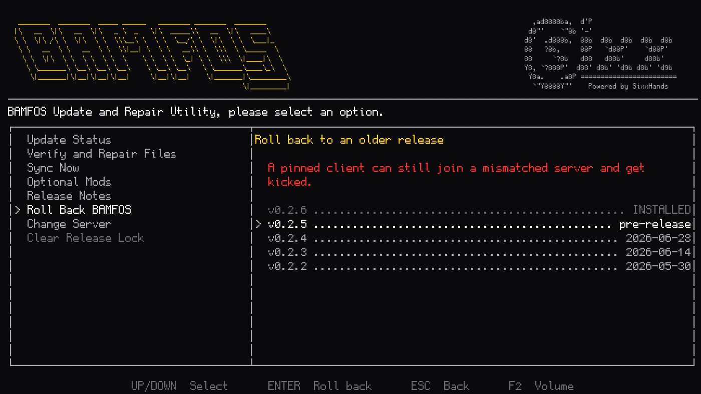

**Pointing the client at a new server**

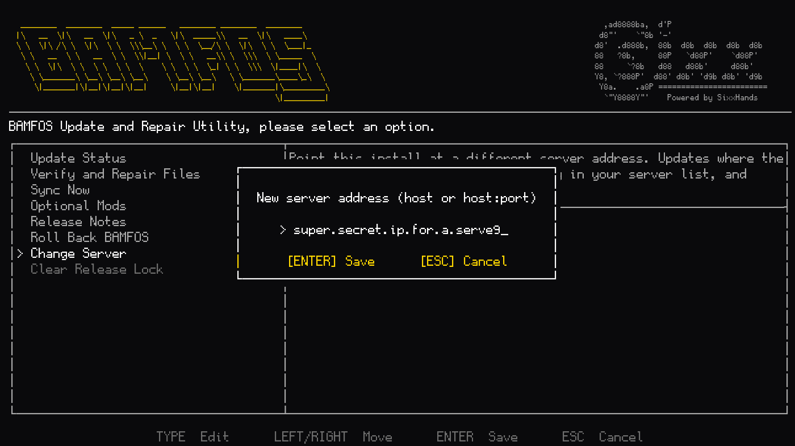

**What changed this release**

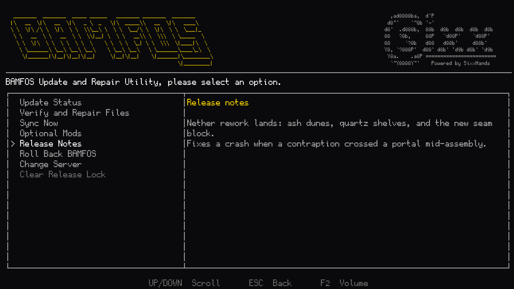

## On a dedicated server

Servers don't have a boot window, so the updater prints the same status in the console before the game JVM starts. That way updates finish before anyone can join.

```
[BAMFOS UPDATER] new release v0.2.6 discovered (server on v0.2.4)
[BAMFOS UPDATER] updating server v0.2.4 -> v0.2.6 (34 files) before the server opens
  cobblemon-neoforge-1.6. [############################..] 93%  44.7/48.0 MB
[BAMFOS UPDATER] updated server v0.2.4 -> v0.2.6
```

The progress bar only draws on an interactive terminal; if output is piped to a log file it falls back to plain per-file lines so the log doesn't fill up with carriage-return spam.

### Commands

All server commands live under `/bamfos` (permission level 2, server-only mod). Run `/bamfos` with no args to print the list in-game.

| Command | What it does | Note |
|---|---|---|
| `/bamfos status` | version, release lock, last sync, token, next poll, armed restart | |
| `/bamfos reload` | re-read `bamfos-updater.properties` without restarting | |
| `/bamfos check` | poll GitHub now instead of waiting for the timer | can arm a restart |
| `/bamfos sync` | download the release now (applies on next restart) | |
| `/bamfos repair` | hash-check managed files and restore anything that drifted | |
| `/bamfos restart now` | run an armed restart immediately | kicks everyone |
| `/bamfos restart cancel` | cancel an armed countdown and skip that release for this session | |
| `/bamfos stop` | shut the server down and keep it down | kicks everyone |
| `/bamfos cleartoken` | clear the dead-token marker after fixing your token | |

A couple things to keep in mind:
- `/bamfos check` runs the full update check, so if `auto_restart` is on it can announce a new release and start the restart countdown right away.
- Use `/bamfos stop` instead of vanilla `/stop` when running under the restart wrapper; the wrapper relaunches the server after a normal `/stop` so update restarts work, while `/bamfos stop` tells it to stay down.
- None of these swap mod jars live. FML keeps every jar in `mods/` open while the server runs, so mod changes are staged and applied on the next restart.

## Layout

| Module | What it is |
|---|---|
| `mainmenu/` | client mod (window icon, loading screen, splashes, mismatch BSOD) |
| `earlywindow/` | early-window POST/BIOS terminal and minigames (separate service jar loaded before mods) |
| `bamfos-updater-boot/` | frozen boot stub that picks and loads the updater core |
| `bamfos-updater-core/` | hot-updatable core that manages the engine jar |
| `bamfos-updater-engine/` | release fetcher, file reconciler, and client/server sync logic |
| `bamfos-updater-watchdog/` | server-side release polling, `/bamfos` commands, and restart countdowns |
| `bamfrestore/` | server-side Simple Backups world restore mod |
| `tools/` | screenshot/render scripts and test helpers |

## Regenerating the images

```
python tools/shoot.py assets
python tools/repair_render.py <outdir>
```

`shoot.py` launches the real early window with mock `bus.log` events and saves screenshots of each boot state. `repair_render.py` renders the BIOS Update & Repair screens and checks for text/layout overlaps, and `bsod_render.py` captures the disconnect blue screen.
