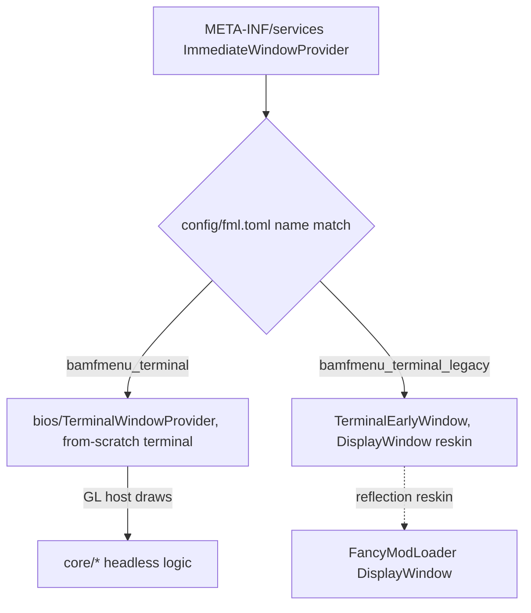

# early, the pre-Minecraft BIOS early-window service layer
## Features
The root of the `bamfmenu` early window: a NeoForge `ImmediateWindowProvider` service jar that draws a black
IBM/DOS-style terminal + the BAMF! rhythm game on its own GLFW/OpenGL canvas before Minecraft exists, then
hands the window off to the game. It loads on the SERVICE module layer of FancyModLoader, before any
`@Mod`/Minecraft/Mixin class, so everything under here must be self-contained: Java stdlib + LWJGL + FML
early-display, never a Minecraft or mod class. The package is two halves out of the `TerminalWindowProvider`
god-class decomposition: `core/` is headless reusable logic, `bios/` is the GL presentation/host. The one
class directly in this root, `TerminalEarlyWindow`, is the legacy fallback provider, kept so config can point
back to a `DisplayWindow` reskin if the from-scratch terminal ever fails to hand off.

## Components
- **`TerminalEarlyWindow`** is the legacy/fallback `ImmediateWindowProvider`. It extends FancyModLoader's own
  `DisplayWindow` instead of reimplementing window creation + the fragile Minecraft hand-off, those are
  untouched. It only changes what is drawn: black background, DOS light-gray foreground, and the
  render-element list reflectively swapped to a text-only set (the real startup log + progress + performance
  bars, no Mojang logo). All the curation is best-effort reflection in try/catch, so on any FML internals
  change it falls back to the normal window and the game still boots.
  - `name()`: the id `"bamfmenu_terminal_legacy"`, matched against `config/fml.toml`. Deliberately not
    `"fmlearlywindow"`.
  - `updateModuleReads(ModuleLayer)`: overrides the caller-sensitive inherited version (it throws
    `IllegalCallerException` when subclassed) and re-wires the private `loadingOverlay` handle to
    `NeoForgeLoadingOverlay.newInstance`, so the inherited phase-2 hand-off still works.
  - `initialize(String[])`: wraps the super tick to call `curate()` each frame. The private helpers drive the
    one-time element swap + the per-tick black-scheme enforcement by reflection.
  - runs on FML's early-display tick, not the from-scratch render thread the `bios/` terminal owns.

The REAL terminal (`TerminalWindowProvider`, named `"bamfmenu_terminal"`) and all its machinery
live in `bios/`, not here. This root keeps only the fallback. Both provider FQNs are listed in
`META-INF/services/...ImmediateWindowProvider`, and which one runs is chosen by the per-instance
`config/fml.toml` (`earlyWindowProvider=` + `earlyWindowControl=true`), seeded by the pack profile and
self-healed by the main `@Mod`.

## How it works
NeoForge reads the SPI service file, finds both provider classes, and instantiates the one whose `name()`
matches `config/fml.toml`. The default is `"bamfmenu_terminal"` -> `bios/TerminalWindowProvider`, the
from-scratch terminal. `TerminalEarlyWindow` is the safety valve: point `config/fml.toml` back to
`"bamfmenu_terminal_legacy"` and FML runs this class instead, which boots the stock `DisplayWindow` and merely
reskins it. Either way the inherited `DisplayWindow` hand-off carries the GL window into Minecraft. The two
subfolders carry the bulk of the system: `core/` produces headless game/audio/chart/song state, `bios/`
consumes it to draw and host the screens.

## Dependencies
- **Depends on:** FancyModLoader's `net.neoforged.fml.earlydisplay.*` (`DisplayWindow`, `ColourScheme`,
  `RenderElement`, `SimpleFont`) and `NeoForgeLoadingOverlay` (resolved reflectively from the `neoforge`
  module at hand-off), plus Java reflection. `TerminalEarlyWindow` imports no sibling class in `core/` or
  `bios/`.
- **Depended on by:** the SPI service file + `config/fml.toml` (by string FQN/name). The main `@Mod`'s
  `EarlyWindowKeying` provisions the `fml.toml` key that selects a provider here.
- No Minecraft/`@Mod`/Mixin class anywhere under this layer. The two provider FQNs in the SPI file stay in
  lockstep with this package.
- The `core/` half never imports `bios/`. The `bios/` render thread owns all GL + game state,
  `onKey`/`onChar` only enqueue from the main thread. `TerminalEarlyWindow` itself follows neither rule: it
  rides FML's own `DisplayWindow` tick.

## Child layers
- `core/` is the headless, editor-reusable logic in six categories, never imports `bios/`.
- `bios/` is the GL presentation + host: `TerminalWindowProvider` (the real terminal), the canvas, screens,
  overlays, transitions, the BIOS state cache. May import `core/`.
