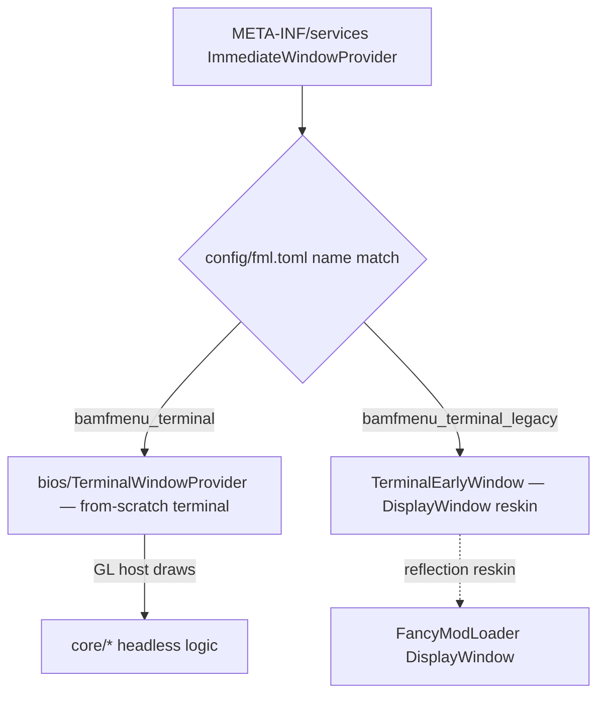

# early — the self-contained pre-Minecraft "BIOS" early-window service layer
## Intent
This is the root of the `bamfmenu` early window: a NeoForge `ImmediateWindowProvider` **service jar** that draws a
black IBM/DOS-style terminal + the "BAMFBEAT" rhythm game on its own GLFW/OpenGL canvas **before Minecraft exists**,
then hands the window off to the game. Because it loads on FancyModLoader's SERVICE module layer (before any
`@Mod`/Minecraft/Mixin class), everything under here must be completely self-contained — only Java stdlib + LWJGL
(GLFW/OpenGL/OpenAL/STB) + FML early-display, never a Minecraft or mod class. The package is split into two halves
(`core/` = headless reusable logic, `bios/` = the GL presentation/host) that grew out of the .75 god-class
decomposition (`TerminalWindowProvider` 3409 → ~2180 lines); the one class that lives *directly* in this root,
`TerminalEarlyWindow`, is the **legacy fallback** provider, retained from so config can point back to a
DisplayWindow-based reskin if the from-scratch terminal in `bios/` ever fails to hand off.

## Components
- **`TerminalEarlyWindow`** — the legacy/fallback `ImmediateWindowProvider`, implemented by **extending FancyModLoader's
  own `DisplayWindow`** rather than reimplementing GLFW window creation + the fragile Minecraft hand-off (those are
  inherited untouched). It only changes what is *drawn*: forces the background to black, retints the foreground to DOS
  light-gray, and reflectively swaps `DisplayWindow`'s render-element list for a text-only terminal set (the real
  startup log + progress + performance bars, dropping the Mojang logo/mascot). All curation is best-effort reflection
  wrapped in try/catch, so on any FML internals change it silently falls back to the normal window and the game still
  boots. Key methods: `name()` returns the unique id `"bamfmenu_terminal_legacy"` (matched against `config/fml.toml`;
  deliberately NOT `"fmlearlywindow"`); `updateModuleReads(ModuleLayer)` overrides the inherited caller-sensitive
  version (which throws `IllegalCallerException` when subclassed) and re-wires the private `loadingOverlay` method
  handle to `NeoForgeLoadingOverlay.newInstance` so the inherited phase-2 hand-off still works; `initialize(String[])`
  wraps the super tick to call `curate()` each frame. Private helpers `curate`/`forceBlack`/`forceTerminalForeground`/
  `readField`/`writeField` drive the one-time element swap + per-tick black-scheme enforcement via reflection on
  `DisplayWindow`/`ColourScheme` private fields. This runs on FML's early-display tick (not the from-scratch render
  thread that the `bios/` terminal owns).

The **real** text terminal + rhythm game (`TerminalWindowProvider`, named `"bamfmenu_terminal"`) and all of its
machinery live in the `bios/` subfolder, not here; this root holds only the fallback. Both provider FQNs are listed
in `META-INF/services/net.neoforged.neoforgespi.earlywindow.ImmediateWindowProvider`, and which one runs is chosen by
the per-instance `config/fml.toml` (`earlyWindowProvider=` + `earlyWindowControl=true`), seeded by the pack profile /
self-healed by the main `@Mod`.

## How it works
Discovery: NeoForge reads the SPI service file, finds both provider classes in this package tree, and instantiates the
one whose `name()` matches `config/fml.toml`. The default selection is `"bamfmenu_terminal"` → `bios/TerminalWindowProvider`
(the from-scratch terminal). `TerminalEarlyWindow` here is the safety valve: point `config/fml.toml` back to
`"bamfmenu_terminal_legacy"` and FML runs *this* class instead, which boots the stock `DisplayWindow` and merely
reskins it to a black terminal via reflection. Either way the inherited `DisplayWindow` hand-off carries the GL window
into Minecraft. The two subfolders carry the bulk of the system: `core/` produces headless game/audio/chart/song
state, and `bios/` consumes it to draw on the live GL canvas and host the screens.

## Boundaries
- **Depends on:** FancyModLoader's `net.neoforged.fml.earlydisplay.*` (`DisplayWindow`, `ColourScheme`, `RenderElement`,
  `SimpleFont`) and `net.neoforged.neoforge.client.loading.NeoForgeLoadingOverlay` (resolved reflectively from the
  `neoforge` module at hand-off), plus Java reflection. `TerminalEarlyWindow` imports **no** sibling class in `core/`
  or `bios/` — it is independent of the from-scratch terminal.
- **Depended on by:** the SPI service file + `config/fml.toml` (by string FQN/name); the main `@Mod`'s
  `EarlyWindowKeying` provisions the `fml.toml` key that selects a provider here.
- **Invariants:** no Minecraft/`@Mod`/Mixin class may be referenced anywhere under this layer (self-contained service
  jar); the two provider FQNs in the SPI file must stay in lockstep with this package; the `core/` half never imports
  `bios/`; the `bios/` render thread owns all GL + mutable game state while `onKey`/`onChar` only enqueue from the main
  thread — but note `TerminalEarlyWindow` itself follows neither (it rides FML's own `DisplayWindow` tick, not the
  from-scratch render thread).

## Child layers
- `core/` — headless, editor-reusable logic (DSP/charting, rhythm scoring, song manifests, audio, panel animation, JSON, tetris/special); never imports `bios/`. See its README.
- `bios/` — the GL presentation + host: `TerminalWindowProvider` (the real terminal), `TerminalCanvas`, screens, overlays, transitions, BIOS state cache; may import `core/`. See its README.
