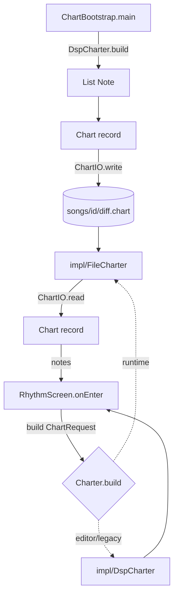

# early/core/rhythm/chart — the chart seam: where BAMFBEAT notes come from, and the committed `.chart` model/format
## Intent
This layer is the single seam between *"where the note chart comes from"* and the rhythm game, plus the in-memory
model and text format for a committed chart. It exists so the head (`RhythmScreen.onEnter`) is simply *"fed a
chart"* — it only ever calls `Charter.build(req)` and reads the returned `List<RhythmEngine.Note>` — while the
*source* of those notes can swap in ONE place. Per the plan doc's , the runtime stops DSP-charting live
every play and instead loads a committed `songs/<id>/<difficulty>.chart`; the `Charter` interface makes that a true
one-line swap from `DspCharter` to `FileCharter`. `Chart`/`ChartIO` are the Phase-4 on-disk form; `ChartBootstrap`
is the dev-only generator that commits those files so file-loaded play reproduces today's live output exactly.
Everything here is pure data + logic — no GL, no OpenAL, no Minecraft.

## Components
- **`Charter`** (interface) — the ONE generate seam. Single method `List<RhythmEngine.Note> build(ChartRequest req)`,
  never null; an empty list means "no chart" and the caller decides the fallback. Implementations live in `impl/`.
- **`Chart`** (record) — one committed difficulty's chart: `String difficulty` (also the filename token), `double bpm`
  (informational tempo hint, 0 = auto), `int preRollMs` (Phase-4 silent scroll-in lead-in; `0` today), and
  `List<RhythmEngine.Note> notes` (sorted ascending by `timeMs` on load). `static final int VERSION = 1` is bumped
  only on incompatible format changes; helper `isEmpty()`. Pure data, the in-memory form of a `.chart` file.
- **`ChartIO`** (final, static utility; private ctor) — read/write the hand-rolled, dependency-free `.chart` text
  format. `static String write(Chart)` serializes (header `key value` lines + `timeMs lane holdMs` note rows, notes
  written in time order); `static Chart read(String text, String fallbackDifficulty)` parses **tolerantly** — unknown
  header keys ignored, missing ones defaulted, malformed note rows skipped, never throws (worst case = empty notes).
  The header `notes N` count is informational; the actual rows are trusted. Private helpers `parseNote` (rejects
  negative time/lane/hold; `holdMs` optional), `parseDouble`, `trimNum` (whole numbers print without `.0`).
- **`ChartBootstrap`** (final; `main`) — DEV-ONLY Phase-4 bootstrap, run **headless** via the `:earlywindow:genCharts`
  Gradle task, **never invoked at runtime**. For every `SongRegistry.SONGS` song it decodes audio via
  `AudioPlayer.analyzeOnly()` (no OpenAL/GL), runs the EXACT runtime charter `new DspCharter().build(...)` with the
  song's own `DetectorConfig` (forced `withLeadInMs(0)` to keep opening notes), wraps the notes in a `Chart`, and
  writes `<outputDir>/<songId>/normal.chart` via `ChartIO.write`. Usage: `java ... ChartBootstrap <outputDir>`.

## How it works
There are two flows through this layer. **Authoring (dev-time):** `ChartBootstrap.main` walks `SongRegistry.SONGS`,
decodes each song, calls `DspCharter` to produce notes that match what the live game charts today, packs them into a
`Chart`, and serializes with `ChartIO.write` to `<id>/normal.chart`. **Runtime:** the head builds a
`ChartRequest` and calls `Charter.build(req)`; the file-backed `impl/FileCharter` resolves `req.chartPath()`, reads
the classpath resource, and calls `ChartIO.read` to parse it back into a `Chart`, returning `chart.notes()` to the
engine. `Chart`'s note type is `RhythmEngine.Note` (lane/timeMs/holdMs) — the same type the engine consumes — so the
seam keeps handing the head a `List<Note>` and nothing downstream changes regardless of which `Charter` is active.

## Boundaries
- **Depends on:** `early.core.rhythm.RhythmEngine` (for `Note`), and — only in the editor/bootstrap-facing classes —
  `early.core.rhythm.chart.impl` (`ChartRequest`, `DspCharter`), `early.core.audio.AudioPlayer`,
  `early.core.song.SongDef`/`SongRegistry`, and `early.core.tuning.DetectorConfig`. All `early.core.*` — this is core
  logic, headless and editor-reusable.
- **Depended on by:** the rhythm head/host in `bios/` (which calls `Charter.build` and consumes `Chart.notes()`),
  the `impl/` charters, and the dev `genCharts` Gradle task.
- **Invariants:** core never imports `bios/` — nothing here touches GL/OpenAL/Minecraft (pure data + parsing).
  `ChartIO.read` never throws (tolerant parse). `Charter.build` is never null (empty list = "no chart"). `Chart`
  notes are sorted ascending by `timeMs` after `read`/`write`. `ChartBootstrap` runs only headless at dev time.

## Child layers
- `impl/` — the `Charter` implementations and the `ChartRequest` carrier: `DspCharter` (runtime/editor DSP onset
  charter chain), `FileCharter` (Phase-4 committed-chart loader + jukebox `hasChart` source of truth), `ChartRequest`
  (immutable build inputs), `ChartGenerator` (the peak-picking note generator). See its README.
